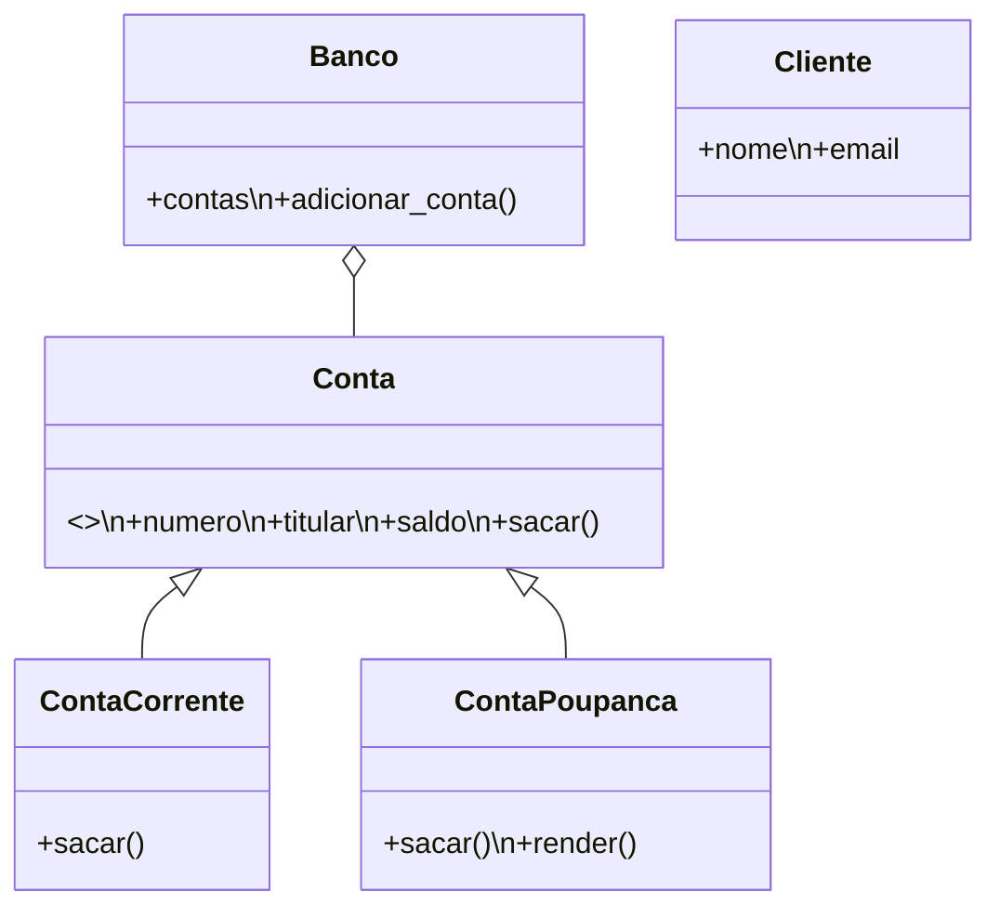

# Semana 06 — Sistema bancário orientado a objetos

Execute com `python3 main.py`.

## Modelagem

O projeto possui classe abstrata, herança com `super()` implícito pelo construtor herdado, encapsulamento com `@property`, polimorfismo em `sacar`, métodos `__str__`, `__repr__` e `__eq__`, dez instâncias de contas e tratamento de entradas inválidas. `Banco` usa composição para manter suas contas.

Também há uma versão comentada em `main.por`, representando classes, herança e polimorfismo em Portugol.
